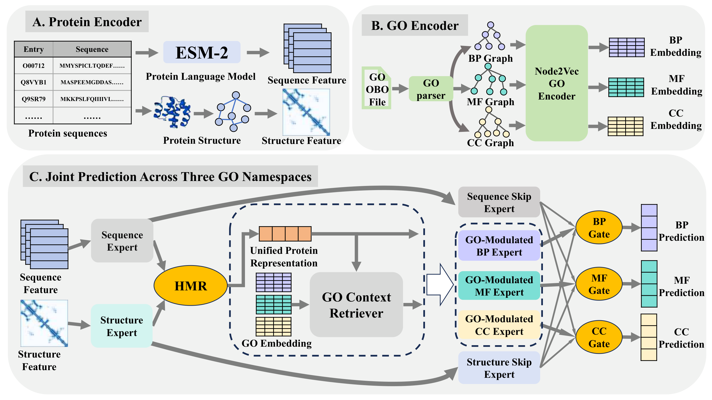

# TriGO

TriGO is a GO-context-guided tri-namespace framework for joint protein function prediction. It jointly learns biological process (BP), molecular function (MF), and cellular component (CC) while sharing protein-side evidence and retaining namespace-specific semantic pathways.

The implementation contains:

- a hierarchical modality router for sequence and structure representations;
- modality-specific skip experts shared by the three prediction branches;
- protein-conditioned GO context retrieval and GO-modulated namespace experts;
- independent BP, MF, and CC routing gates and GO-similarity predictors;
- optional cross-namespace semantic refinement; and
- an imbalance-aware multi-branch loss for sparse, long-tailed GO labels.

## Framework

<p align="center">
  
</p>

<p align="center">
  <b>Overview of TriGO.</b> HMR integrates sequence and structural evidence into a unified protein representation while preserving modality-specific skip paths. Namespace-specific GO contexts guide three GO-modulated experts, and independent branch gates generate BP, MF, and CC predictions.
</p>

<p align="center">
  <a href="assets/trigo_framework.pdf">Download the vector version of the framework</a>
</p>

## Repository contents

```text
TriGO/
  .gitignore                     exclusions for data, checkpoints, and outputs
  requirements.txt              pinned Python dependencies
  assets/
    trigo_framework.png        framework displayed in README
    trigo_framework.pdf        vector version of the framework
  train_model.py                 training and component-ablation entry point
  test_model.py                  checkpoint evaluation
  predict.py                     prediction for cached features or new PDB files
  configs/                       CAFA3, GOA, and CAFA5 reproduction commands
  scripts/
    prepare_go_embeddings.py     namespace-wise GO Node2Vec encoding
    prepare_protein_features.py  ESM-2 and structure feature caching
    smoke_test.py                dataset-free CPU forward check
  trigo/
    data_pipeline/               annotations, PDB parsing, ESM, and feature cache
    go_term/                     GO parsing, graph construction, and Node2Vec
    protein_ple/                 protein experts and hierarchical routing
    multi_branch/                GO retrievers, experts, gates, and refinement
    training/                    loss functions, engine, and metrics
  DATA.md
  DEPENDENCIES.md
  REPRODUCIBILITY.md
  ABLATIONS.md
```

Only source code, documentation, and framework assets are included. Data, pretrained weights, cached features, checkpoints, and experiment outputs must be stored separately.

## Installation

```bash
git clone https://github.com/Cao-Labs/TriGO.git
cd TriGO
python -m venv .venv
source .venv/bin/activate
python -m pip install --upgrade pip
python -m pip install -r requirements.txt
```

See [DEPENDENCIES.md](DEPENDENCIES.md) for package roles and CPU/GPU notes.

Verify the installation without downloading data or model weights:

```bash
python scripts/smoke_test.py
```

## Prepare inputs

The annotation workbook requires `Entry`, `Sequence`, and `Gene Ontology IDs` columns; an optional `Split` column can define train, validation, and test partitions. PDB files are named `{Entry}.pdb`. See [DATA.md](DATA.md) for the complete schema.

Generate GO embeddings:

```bash
python scripts/prepare_go_embeddings.py \
  --obo-path data/cafa3/go-basic.obo \
  --output-path data/cafa3/go_node2vec_embeddings.pt \
  --embedding-dim 256 \
  --device cuda
```

Generate cached protein features with ESM-2 and C-alpha structures:

```bash
python scripts/prepare_protein_features.py \
  --xlsx-path data/cafa3/annotations.xlsx \
  --pdb-dir data/cafa3/pdb \
  --obo-path data/cafa3/go-basic.obo \
  --cache-dir data/cafa3/protein_feature_cache \
  --esm-model-path pretrained/esm2_t33_650M_UR50D.pt \
  --esm-layer 33 \
  --max-residues 1022 \
  --contact-threshold 8.0 \
  --device cuda
```

## Train

The three principal configurations use portable relative paths:

```bash
./configs/train_cafa3.sh
./configs/train_goa.sh
./configs/train_cafa5.sh
```

These reported-dataset configurations require a complete `Split` column and stop with an error rather than silently replacing the prescribed split with a random partition.

To keep data and outputs outside the repository:

```bash
DATA_ROOT=/datasets/trigo OUTPUT_ROOT=/experiments/trigo DEVICE=cuda:0 \
  ./configs/train_cafa3.sh
```

All architecture, loss, refinement, single-branch, and ablation switches are available through:

```bash
python train_model.py --help
```

The configuration scripts forward additional command-line arguments to `train_model.py`. See [ABLATIONS.md](ABLATIONS.md) for the five paper-aligned component variants and [REPRODUCIBILITY.md](REPRODUCIBILITY.md) for the dataset-specific refinement settings and saved artifacts.

## Evaluate a checkpoint

When `run_config.json` is beside `best_model.pt`, the evaluator restores the training data and GO-space settings automatically:

```bash
python test_model.py \
  --checkpoint outputs/cafa3/best_model.pt \
  --output-dir outputs/cafa3_evaluation \
  --device cuda:0
```

Paths can also be supplied explicitly with `--xlsx-path`, `--pdb-dir`, `--obo-path`, `--feature-cache-dir`, and `--go-embedding-path`.

## Predict new proteins

Prediction can consume existing cached `.pt` features:

```bash
python predict.py \
  --checkpoint outputs/cafa3/best_model.pt \
  --feature-path /path/to/P12345.pt \
  --output-dir outputs/predictions \
  --top-k 20 \
  --device cuda:0
```

It can also build a feature cache directly from a PDB file:

```bash
python predict.py \
  --checkpoint outputs/cafa3/best_model.pt \
  --pdb-path /path/to/P12345.pdb \
  --entry P12345 \
  --esm-model-path pretrained/esm2_t33_650M_UR50D.pt \
  --output-dir outputs/predictions \
  --device cuda:0
```

The predictor writes top-ranked BP, MF, and CC terms to JSONL and TSV files, with optional dense score matrices.
